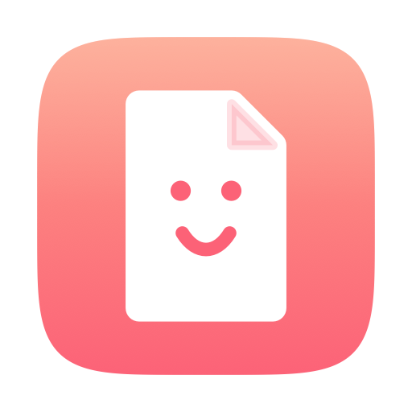

# Domark — Kitchen Sink

A normal paragraph, long enough to wrap across several lines, so the line spacing and the measure of the text column can be judged at a glance rather than guessed at.

## Heading level 2

### Heading level 3

#### Heading level 4

##### Heading level 5

###### Heading level 6

---

## Inline styles

plain · **bold** · *italic* · ***bold and italic*** · ~~struck through~~ · `inline code` · **`code inside bold`**

External link: [Apple's swift-markdown](https://github.com/apple/swift-markdown)

Link inside bold: **[click here](https://swift.org)**

This line ends with a backslash\
← the new line belongs here

## Lists

- First item
- Second item with **bold** in it
- Third item, nested
  - Inner item A
  - Inner item B
    - Innermost
- Fourth item

1. One
2. Two
3. Three
   1. Three point one
   2. Three point two

Starting from another number:

5. Five
6. Six
7. Seven

## Task list

- [x] Set up the Swift package
- [x] Write the AST-based renderer
- [ ] Add syntax highlighting
- [ ] Draw an app icon

## Blockquote

> A single-level quote, with **bold** and `code` in it.
>
> A second paragraph inside the same quote.
>
> > A quote inside a quote
> >
> > - with a list inside it
> > - and another item

## Code

No language:

```
$ swift build
Build complete!
```

Swift:

```swift
@MainActor
@Observable
final class DocumentStore {
    private(set) var blocks: [IdentifiedBlock] = []

    func open(_ url: URL) {
        self.url = url
        reload()
    }
}
```

A line wider than the column, to check horizontal scrolling:

```bash
swift build -c release && codesign --force --sign - build/Domark.app && open -a Domark Fixtures/kitchen-sink.md
```

## Syntax highlighting

Python:

```python
@dataclass
class Reader:
    """Opens Markdown and remembers where you were."""
    path: str
    size: int = 15  # points

    def open(self) -> list[str]:
        return [line for line in read(self.path) if line]
```

TypeScript:

```ts
interface Heading { level: number; title: string }

export async function outline(src: string): Promise<Heading[]> {
  const found = src.match(/^#{1,3} .+$/gm) ?? [];
  return found.map((line) => ({ level: line.indexOf(" "), title: `${line}` }));
}
```

Dart:

```dart
class Counter extends StatelessWidget {
  const Counter({super.key, required this.value});
  final int value;

  @override
  Widget build(BuildContext context) => Text('Count: $value');
}
```

Shell:

```sh
# install into ~/Applications
export DEST="$HOME/Applications"
for f in build/*.app; do cp -R "$f" "${DEST}/"; done
```

JSON and YAML:

```json
{ "name": "Domark", "version": 1.0, "native": true, "tags": ["markdown", null] }
```

```yaml
app:
  name: Domark   # the reader
  min-macos: 26.0
  thai: true
```

SQL:

```sql
SELECT title, COUNT(*) AS views
FROM documents -- every opened file
WHERE opened_at > '2026-01-01'
GROUP BY title ORDER BY views DESC LIMIT 10;
```

HTML and CSS:

```html
<!-- a centred logo -->
<p align="center"></p>
```

```css
.page { max-width: 46em; color: #1c1c1e; } /* reading column */
@media (prefers-color-scheme: dark) { .page { color: #f2f2f7 !important; } }
```

Diff:

```diff
--- a/Theme.swift
+++ b/Theme.swift
@@ -12,3 +12,3 @@
-    static let defaultBase: CGFloat = 14
+    static let defaultBase: CGFloat = 15
     static let maxBase: CGFloat = 28
```

Go, Rust, Kotlin and C:

```go
func main() {
	count := len(os.Args) // arguments
	fmt.Printf("%d files\n", count)
}
```

```rust
#[derive(Debug, Clone)]
struct Block<'a> { text: &'a str, level: u8 }

fn main() { let b = Block { text: "hi", level: 2 }; println!("{:?}", b); }
```

```kotlin
data class Doc(val title: String, val words: Int = 0)

fun main() = println(Doc("Domark").copy(words = 42))
```

```c
#include <stdio.h>

int main(void) {
    printf("%s\n", "hello"); /* greet */
    return 0;
}
```

An unknown language stays plain:

```brainfuck
++++++++[>++++[>++>+++<<-]>-]>.
```

## Math

Inline: the roots of $ax^2 + bx + c = 0$ are $x = \frac{-b \pm \sqrt{b^2 - 4ac}}{2a}$, and $e^{i\pi} + 1 = 0$ sits on the line with Thai text — สูตร $a_1 * b_1$ ในประโยค.

Prices are not math: it costs $5 and then $10, and `$PATH` in code stays code.

$$
\sum_{n=1}^{\infty} \frac{1}{n^2} = \frac{\pi^2}{6}
$$

$$\int_0^1 x^2 \, dx = \frac{1}{3}$$

```math
\begin{pmatrix} a & b \\ c & d \end{pmatrix}
```

Broken TeX shows its source and why:

$$\frac{1}{$$

## Tables

| Feature | Status | Notes |
|---|:---:|---:|
| Headings | ✅ | H1–H6 |
| **Bold / italic** | ✅ | including `***nested***` |
| Tables | ✅ | left, centre, right |
| Task lists | ✅ | real checkboxes |
| Syntax highlighting | ✅ | 15 languages |

Wider than the window:

| Column A | Column B | Column C | Column D | Column E | Column F | Column G |
|---|---|---|---|---|---|---|
| a fairly long value | a fairly long value | a fairly long value | a fairly long value | a fairly long value | a fairly long value | a fairly long value |

## Non-Latin text

Kept as a rendering check — these scripts break lines differently from Latin:

ข้อความภาษาไทยที่ยาวพอจะต้องขึ้นบรรทัดใหม่ เพื่อดูว่าตัดคำและตัดบรรทัดถูกต้องไหม ไม่ตกขอบคอลัมน์

日本語のテキストも同じように折り返しを確認します。中文文本也一样。

## Images

An image that cannot load, to check the placeholder:


## Raw HTML

A centred logo and title, the way READMEs open:

<p align="center">
  
</p>

<h3 align="center">Domark</h3>

<p align="center">
  A native Markdown reader.<br>
  Built with <a href="https://github.com/apple/swift-markdown">swift-markdown</a> &amp; SwiftUI &mdash; no web view.
</p>

Inline tags in a sentence: press <kbd>⌘</kbd> <kbd>F</kbd> to find, H<sub>2</sub>O, E = mc<sup>2</sup>, <b>bold</b>,<br>and a line break.<!-- this comment is hidden -->

<details>
<summary>Click to expand — <b>Markdown inside</b></summary>

- a **list** inside the details
- with `code`

```swift
let hidden = "until opened"
```

</details>

<details><summary>Details written on one block</summary>
Plain HTML text, all in one block.
</details>

<!-- a comment on its own is hidden -->

<div align="right">

*Right-aligned Markdown.*

</div>

Unsupported HTML is still shown as code:

<table><tr><td>a table</td></tr></table>

## Other rules

***

___

End of fixture.
