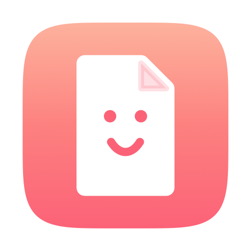
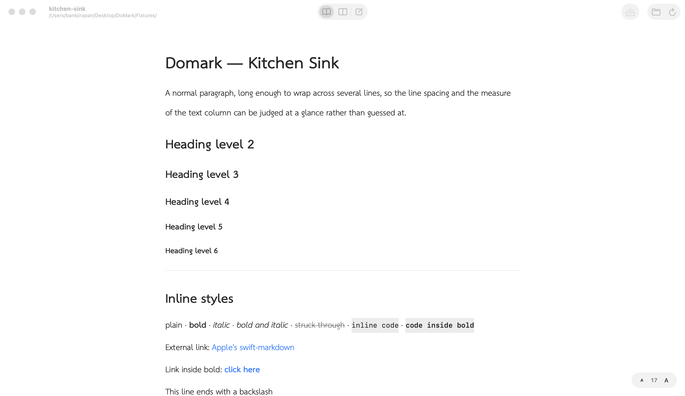
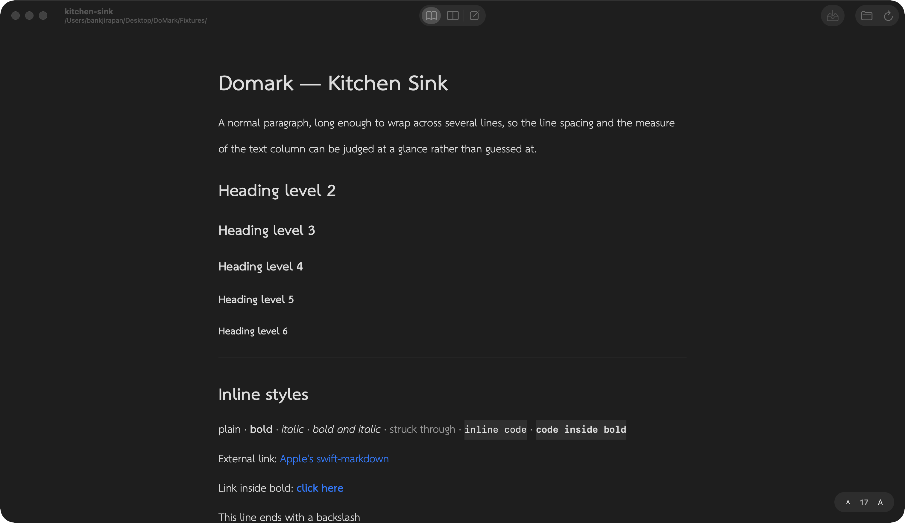
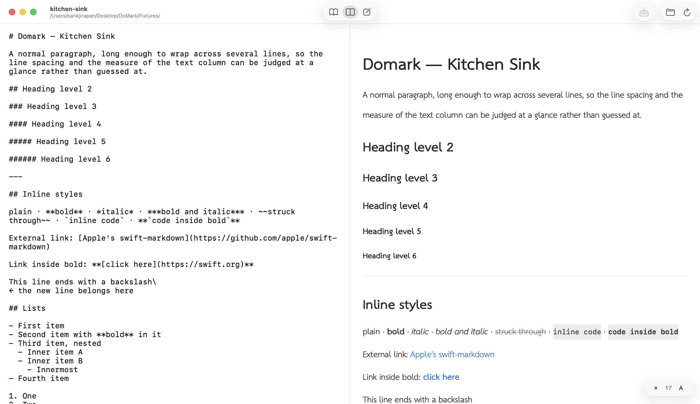

<p align="center">
  
</p>

<h1 align="center">Domark</h1>

<p align="center">
  A fast, native Markdown reader and editor for macOS.<br>
  Built with SwiftUI and Apple's <a href="https://github.com/apple/swift-markdown">swift-markdown</a>, with no web view.
</p>

<p align="center">
  
  
  
</p>

<p align="center">
  
</p>

---

## ✨ Features

- **Native rendering.** Markdown is parsed to an AST and drawn with SwiftUI views, so there's no HTML or WebKit layer.
- **Three view modes.** Switch between **Preview**, **Split** and **Edit** with the toolbar or `⌃⌘1` / `⌃⌘2` / `⌃⌘3`.
- **Edit and save.** The preview updates as you type. Domark also warns you before closing or quitting with unsaved work.
- **Live reload.** When a file changes on disk, Domark reloads it. If you have unsaved edits, it asks whether to use the disk version or keep yours.
- **Folder browsing.** Open a folder to get a sidebar of every Markdown file in it. Move between files with `⌘[` and `⌘]`.
- **Find in the preview.** `⌘F`, `⌘G` and `⇧⌘G` highlight matches in the rendered page, with an option for case-sensitive search.
- **Heading links.** `[jump](#some-heading)` scrolls to that heading inside the app.
- **Full CommonMark and GFM.** Headings, lists, task lists, blockquotes, code blocks, tables with column alignment, images and horizontal rules all render.
- **Thai-friendly typography.** You can pick the reading and code typefaces separately. Fonts that draw Thai are listed first, with optical size correction (TH Sarabun New is used by default if it's installed).
- **Light, dark or match the system.** The floating Liquid Glass control resizes the text.
- **Drag and drop.** Drop a `.md` file or a folder onto the window to open it.

## 📸 Screenshots

| Preview (Dark)                                             | Split view                                                    |
| ---------------------------------------------------------- | ------------------------------------------------------------- |
|  |  |

> The screenshots come from [`Fixtures/kitchen-sink.md`](Fixtures/kitchen-sink.md). To take them again, run `./Scripts/screenshots.sh` (whatever runs it needs Screen Recording permission).

## 🚀 Getting started

### Requirements

- macOS 26 (Tahoe) or later
- Xcode 26 / Swift 6.2 or later

### Build and run

```bash
./Scripts/bundle.sh
```

```bash
open build/Domark.app
```

`bundle.sh` runs `swift build -c release`, wraps the binary in `build/Domark.app` and ad-hoc signs it. Pass `debug` to get a debug build: `./Scripts/bundle.sh debug`.

### Install into /Applications

```bash
./Scripts/install.sh
```

The script quits any running Domark, copies the app into `/Applications` and registers it with Finder. To install for your user only, use `./Scripts/install.sh ~/Applications`.

To open a file in Domark:

- In Finder, right-click → **Open With → Domark**
- To make Domark the default: **Get Info → Open with → Domark → Change All…**
- From the Terminal: `open -a Domark file.md`

## ⌨️ Keyboard shortcuts

| Action                         | Shortcut              |
| ------------------------------ | --------------------- |
| Open file / Open folder        | `⌘O` / `⇧⌘O`          |
| Save / Reload                  | `⌘S` / `⌘R`           |
| Close                          | `⇧⌘W`                 |
| Preview / Split / Edit         | `⌃⌘1` / `⌃⌘2` / `⌃⌘3` |
| Find / Next / Previous         | `⌘F` / `⌘G` / `⇧⌘G`   |
| Bigger / Smaller / Actual size | `⌘+` / `⌘-` / `⌘0`    |
| Next / Previous file           | `⌘]` / `⌘[`           |
| Settings                       | `⌘,`                  |

## 🗂 Project layout

```
Sources/Domark/
├── DomarkApp.swift, AppDelegate.swift   App, menus, opening files from Finder
├── Model/    DocumentStore, FileWatcher, FolderTree, FindSession, settings
├── Render/   Markdown AST → render blocks (BlockBuilder, InlineBuilder, Theme, Fonts)
└── Views/    ContentView, BlockView, code/table/image blocks, editor, sidebar, find bar
Bundle/Info.plist      Bundle metadata and the .md document type
Icon/                  App icon (generated by make-icon.swift)
Fixtures/              kitchen-sink.md, a page that exercises every element
Scripts/               bundle.sh · install.sh · screenshots.sh
```

## 🧭 Roadmap

- [ ] Syntax highlighting in code blocks
- [ ] Rendering raw HTML (it's shown as code for now)
